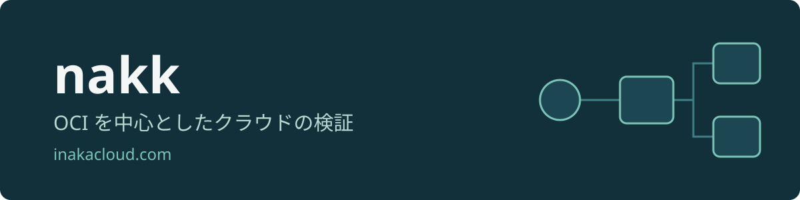

[ブログ](https://inakacloud.com/) ｜ [Zenn](https://zenn.dev/nakk)

OCI（Oracle Cloud Infrastructure）を中心に、クラウドの構築で試したことや気づいたことをブログと Zenn に書いています。

## 記事

| 記事 | 掲載先 |
|---|---|
| [Oracle AI World 2026 参加レポート](https://inakacloud.com/posts/oracle-ai-world-2026-report/) | ブログ |
| [Oracle AI Forum 2026 参加レポート](https://inakacloud.com/posts/oracle-ai-forum-2026-report/) | ブログ |
| [独自ドメインメールを無料で運用する](https://inakacloud.com/posts/cloudflare-email-routing-setup/) | ブログ |
| [AIエージェントに業務を任せる前の確認項目](https://zenn.dev/nakk/articles/ai-agent-3c-checklist) | Zenn |
| [AIエージェントのデータアクセスはデータベース側で守る](https://zenn.dev/nakk/articles/oracle-ai-world-2026-deep-trust) | Zenn |
